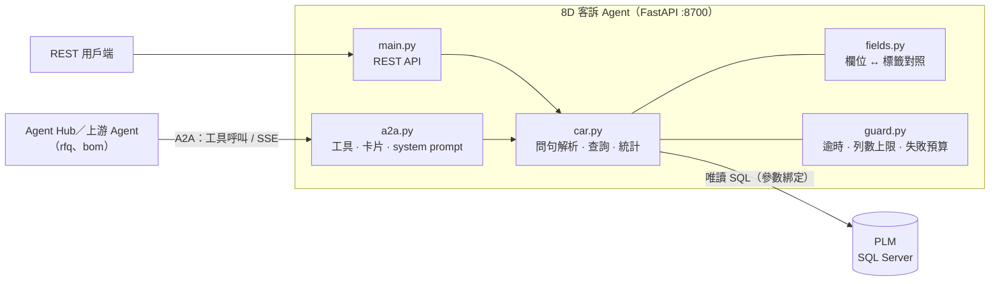
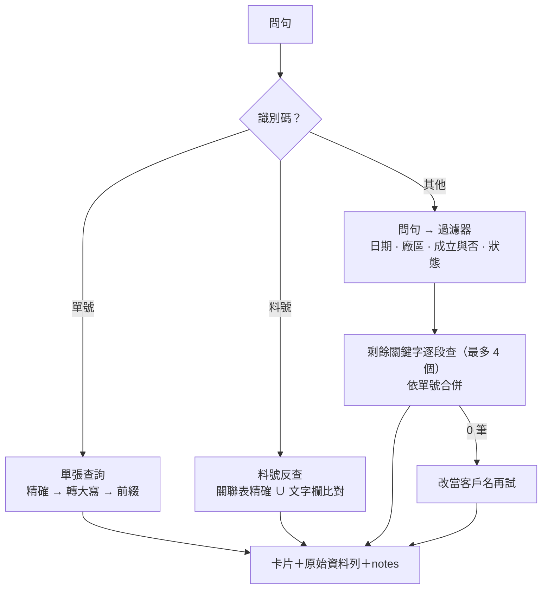

# 8D-Report-RAG — 8D 客訴單即時查詢 Agent

> **一句話介紹**：問「這張單、這顆料、這個客戶以前出過什麼品質問題？原因和對策是什麼？」，它直接查 PLM 上的 8D 客訴單，照單上寫的回答，查不到就明說查不到。

**系統導覽**：[Agent Hub（主入口）](https://github.com/LiN3simver/Agent_Hub_RAG_Frontend) · [Part-RAG](https://github.com/LiN3simver/Part-RAG) · [RFQ-RAG](https://github.com/LiN3simver/RFQ-RAG) · [BOM-RAG](https://github.com/LiN3simver/Bom-RAG) · **8D-Report-RAG** · [ISO-RAG](https://github.com/LiN3simver/ISO-RAG)

> **作品集展示版**：不含 SQL 查詢檔、共用框架 `agentkit` 與連線設定，無法直接執行。客戶、人員、廠區、料號（如 `CON-A70090-1`）、單號（如 `CAR-W250602`）與統計數字皆為虛構。

---

## 專案概覽

品保與業務在報價、換料前需要知道某顆料或某個客戶的客訴史。8D 客訴單只有數百張，全表文字欄掃描就在毫秒級，建向量庫換不到速度、只會換到過期資料，所以這個 Agent **每次直接以唯讀 SQL 查來源庫**，把問句拆成確定性的過濾條件，並以 REST API 與 A2A 工具提供給 LLM 及其他 Agent。

本 Agent 只回報**客訴單上寫了什麼**；不判斷該不該報價、不算風險分數——上游拿這些事實做什麼是上游的事。

| 問法（範例） | 系統做什麼 |
|---|---|
| 「CAR-W250602 的根本原因與對策」 | 單號精確查詢，列出 D3～D8 |
| 「CON-A70090-1 被客訴過嗎？」 | 料號反查（精確關聯 ∪ 文字比對），標示命中方式 |
| 「今年 5 月客訴成立的單」 | 日期、成立與否拆成過濾器，再查關鍵字 |
| 「各廠區的客訴成立率」 | 統計：成立率、狀態、廠區、客戶、異常類型分布 |

## 核心功能

- **多種反查**：單號、料號、客戶、自由文字；每筆結果附命中原因
- **統計分析**：張數、成立率、狀態／廠區／客戶／異常歸類分布
- **限制寫進答案**：「查不到 ≠ 沒出過事」「責任歸屬欄位填答率極低，不可排名」等限制會隨結果一起送給模型

## 系統架構



本 Agent 是**葉節點**：不呼叫任何下游，呼叫圖保持單向無環。

## 檢索流程



- **整句問句不能當 LIKE 字串**：以確定性規則把「今年 5 月」「近半年」「2025 年之後」、廠區、成立與否、狀態拆成 SQL 過濾器，剩下的詞才逐段比對 16 個文字欄
- **否定詞優先**：「客訴**不**成立」也包含「成立」；一般子字串比對會判成歧義並靜靜丟掉過濾器、回傳全庫。正規化時先比否定、再比肯定
- **料號反查兩條路 UNION**：料號同時登記在關聯表與文字欄，約 7% 的單只出現在文字欄。兩條都查，並以 `matched_by` 標示「精確關聯」或「文字比對（可能誤中）」——漏掉一張真客訴比多給一張更糟
- **料號規則排除規格字**：`PH2.0`、`UL2725` 這類規格不會被誤認成料號

## 驗證機制

- **NULL ≠ 不成立、0 ≠ 未填**：「是否成立」為 NULL 代表**尚未判定**，自成一組；成立率分母只算已判定的單。退回數 0 是「真的 0 個」，與未填分開顯示
- **過濾值不靜默忽略**：認不出來的過濾值放進 `ignored`，並在 `notes` 警告，避免使用者拿到全庫數字卻以為是篩選結果
- **回歸測試含反向證據**：`python -m src.car --selftest` 共 81 項斷言，不只驗證現在是對的，也驗證寫錯時會被抓到——D3/D4 欄位對調、JOIN 放大列數、成立／不成立歧義、只登記在文字欄的料號
- **API 煙霧測試**：`tests/smoke_api.py` 共 64 項端點檢查（含「葉節點不得有下游」）

## Agent 協作

| 項目 | 內容 |
|---|---|
| Agent ID | `car8d` |
| 上游（誰會呼叫我） | `rfq` 產品估價（報價前查品質風險）、`bom`（換料前查客訴史） |
| 下游 | 無（葉節點，`can_delegate=False`） |
| 工具 | `get_part_complaints`、`get_complaint`、`search_complaints`、`complaint_stats` |
| 預先查詢 tags | `客訴`、`8D`、`CAR`、`品質異常`、`根本原因` |

- **只開四支工具**：上游模型的工具步數有限，工具越少越不會被吃掉步數
- **工具 description 就是規格書**：資料限制寫在描述裡——那是上游模型唯一看得到的地方，上游的回答因此自帶限制說明
- **問句命中 tags 時由上游先查**：上游不經 LLM 先打本 Agent 的 `/a2a/search`，客訴卡片在模型開口前就已在問句裡

## 技術重點

| 資料陷阱 | 做法 |
|---|---|
| 表單欄位名與內容錯位一格：名為 containment 的欄位裝 **D3 根本原因**、名為 root_cause 的欄位裝 **D4 臨時對策** | 依表單 label 而非欄位名建立別名，對照定義在 [src/fields.py](src/fields.py)，selftest 以內容斷言守住 |
| 清單值的多語系 label 部分為 NULL | 依序取「繁中 → 英文 → 原值」第一個有值的 |
| 清單已刪除、舊單仍在用的退役代碼 | 三層解析：清單 label → 畫面快取 → 裸代碼，舊單仍顯示得出來 |
| 兩份廠區清單代碼不同 | 生產廠區與填單／責任廠區各自 JOIN 自己的清單，不可互換 |
| 狀態「Released」實為「已結案」 | 在欄位層統一轉譯，避免模型誤讀成「已發行」 |

## 量化成果

| 指標 | 數值 |
|---|---|
| 查詢延遲 | 全表文字欄 LIKE 掃描約 12 ms（數百張單），無需向量索引 |
| 料號反查召回 | 補上只登記在文字欄的約 7% 客訴單 |
| 自動化測試 | 81 項 selftest 斷言＋64 項 API 煙霧測試 |

> 延遲與比例為原系統在內部資料上的量測；展示版不含資料，無法重現。

## 技術堆疊

| 類別 | 使用 |
|---|---|
| 服務 | Python 3.12、FastAPI、Uvicorn、httpx |
| 資料 | SQL Server（PLM，唯讀帳號）、pyodbc、參數化 SQL |
| LLM | Anthropic Messages API 相容 gateway（`anthropic` SDK） |
| 多 Agent | agentkit（A2A 契約，維護於 [Agent Hub](https://github.com/LiN3simver/Agent_Hub_RAG_Frontend)） |

## 專案結構

```
main.py              FastAPI 入口與 REST 端點
src/car.py           單張查詢、料號反查、檢索、統計、問句解析、selftest
src/a2a.py           A2A 工具定義、檢索卡片、LLM system prompt
src/fields.py        欄位 ↔ 中文標籤對照（含 D3/D4 錯位）、清單值
src/guard.py         逾時、列數上限、失敗預算
src/db.py            SQL Server 唯讀連線
sql/README.md        查詢層設計（SQL 檔本身不公開）
tests/smoke_api.py   端點煙霧測試
```

| Method | Path | 說明 |
|---|---|---|
| GET | `/api/complaint/{car_no}` | 單張單的全部欄位（D3～D8、關聯料號、通知人員） |
| GET | `/api/part/{part_number}` | 料號反查客訴史 |
| GET | `/api/search` | 自由文字＋過濾（`customer` `factory` `result` `work_type` `state` `since` `until`） |
| GET | `/api/stats` | 張數、成立率、各類分布 |
| POST | `/a2a/tool/{name}` · `/a2a/search` · `/a2a/message` | A2A 工具、統一檢索、委派型對話（SSE） |

## 展示版範圍

- **未收錄**：`sql/*.sql`（分段組裝的查詢檔，設計見 [sql/README.md](sql/README.md)）、`agentkit`、`.env`
- selftest 與煙霧測試需連線到來源庫，展示版無法執行
- 客戶、人員、廠區、料號、單號與統計數字皆為虛構或經去識別化
